# Changed Ukrainian Language

Українська локалізація для гри Changed. У цьому репозиторії ви знайдете файли різних версій перекладу, скриншоти та інструкцію зі встановлення.

### Наразі найактуальніша версія - **0.3.351**. 

Завантажити її можна [тут](https://github.com/elik7777/GameChangedUkrainianLanguage/raw/main/Version%20language/2.X.X/0.3.351/Translate%200.3.351.zip).

---

## Встановлення локалізації

### 1. Завантажте необхідні файли
* Завантажте актуальний zip архів [Таблиці версій](#таблиця-версій)

### 2. Замініть файли гри
* Розпакуйте файли zip архіву у папці гри.

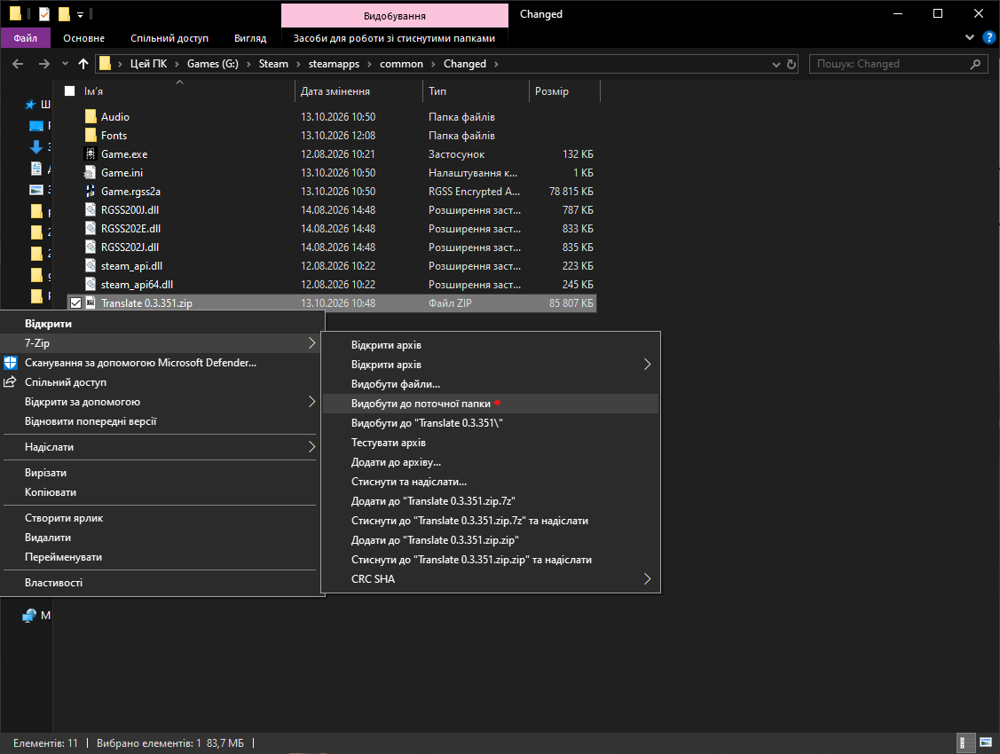

### 3. Запустіть гру
  
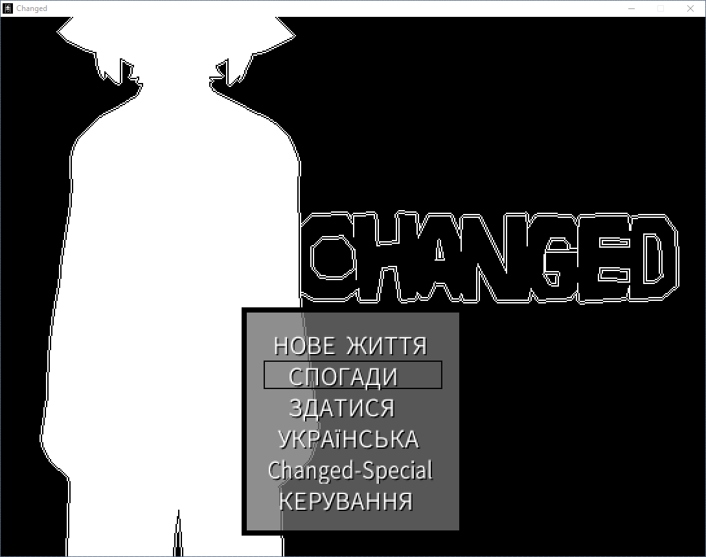

---

Знизу пояснення по версіях

## Таблиця версій

| Версія | Актуальна |
| :---: | :---: |
| [0.3.351](https://github.com/elik7777/GameChangedUkrainianLanguage/raw/main/Version%20language/2.X.X/0.3.351/Translate%200.3.351.zip) | + |

---

### Напишіть [тут](https://github.com/elik7777/GameChangedUkrainianLanguage/issues) якщо помітили помилки перекладу

---

  
Переглянути скриншоти

  
   
  
  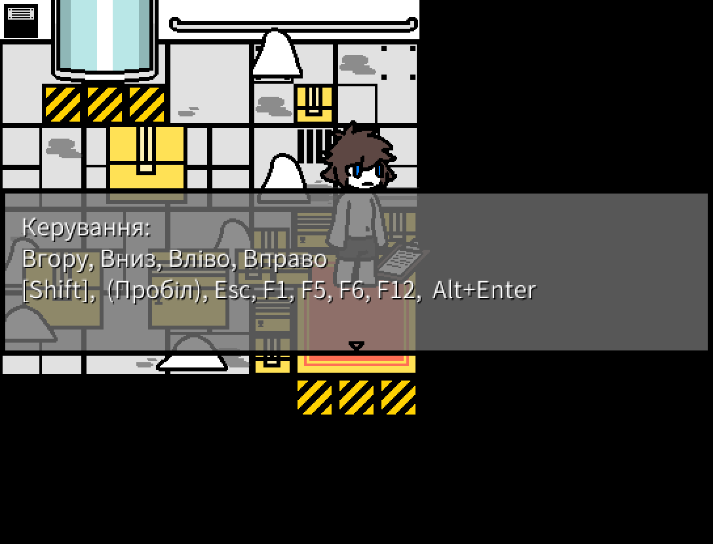
  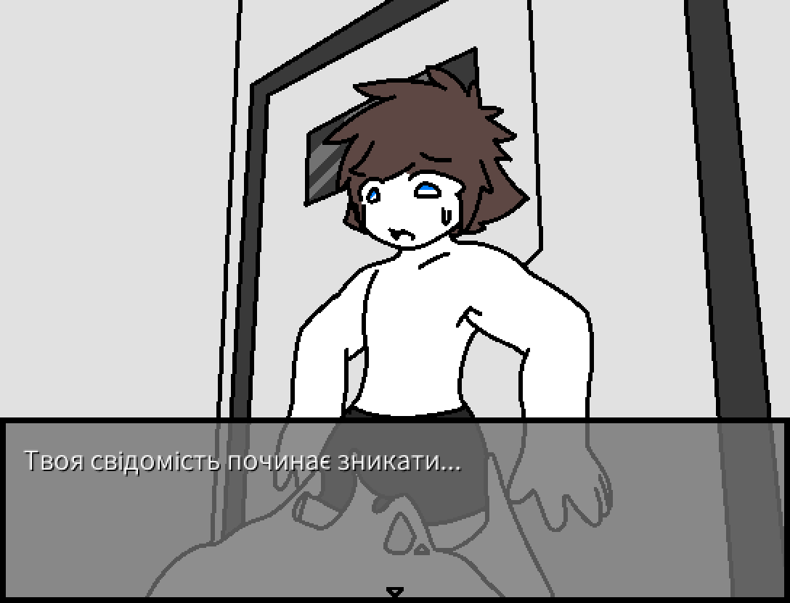
  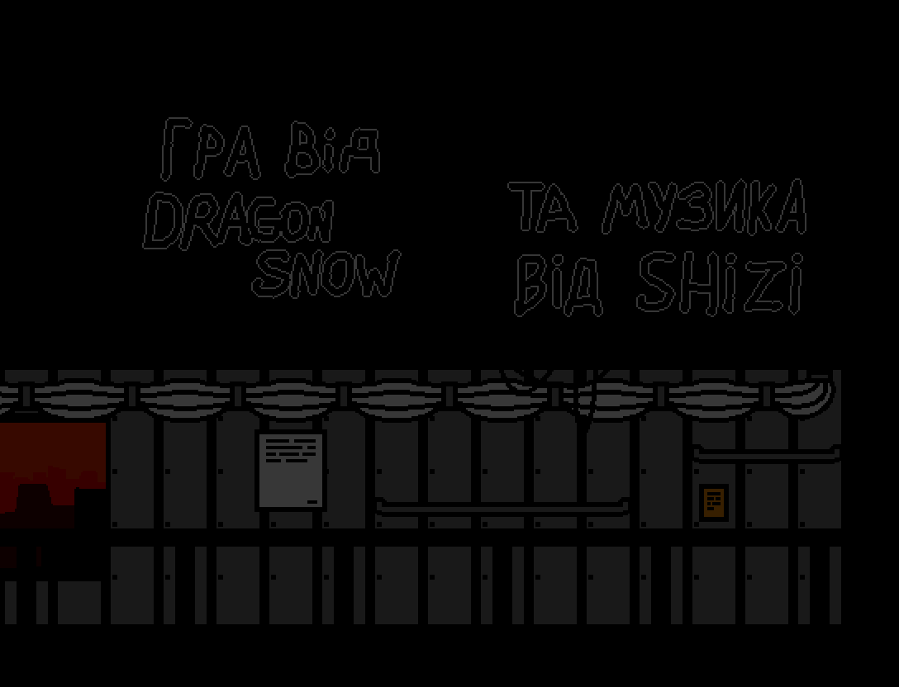
  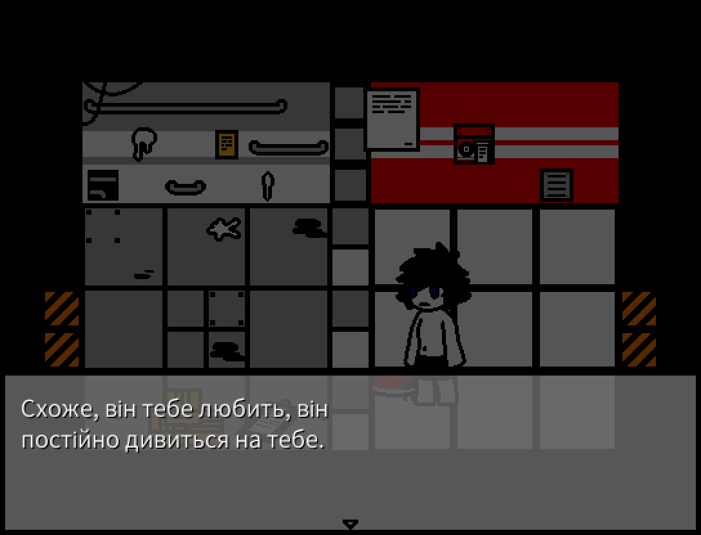
  
  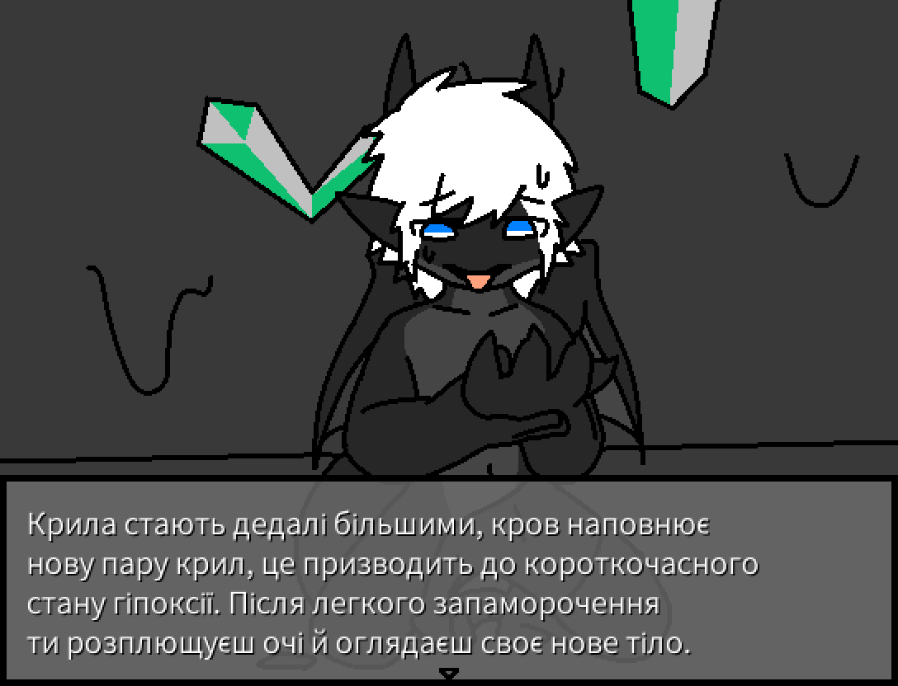
  
  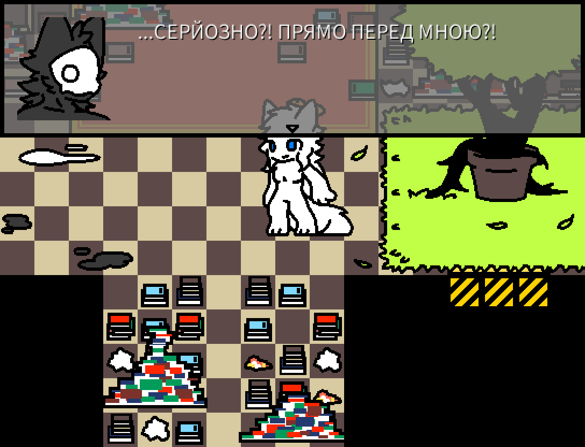
  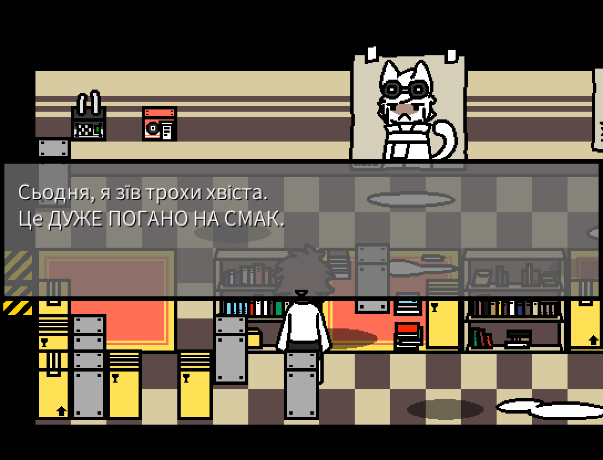
  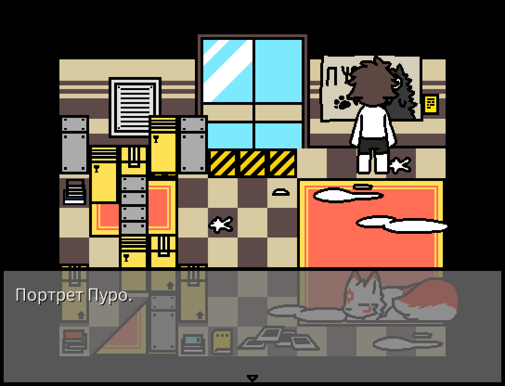
  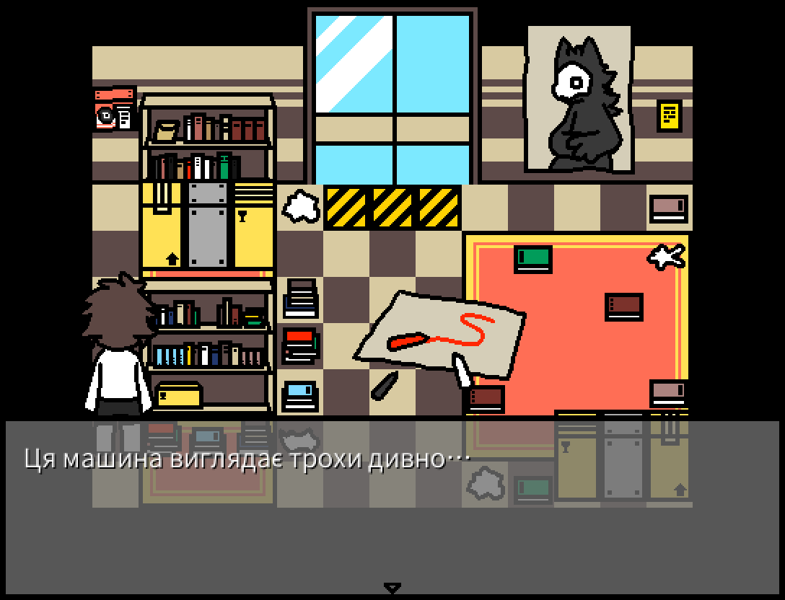

